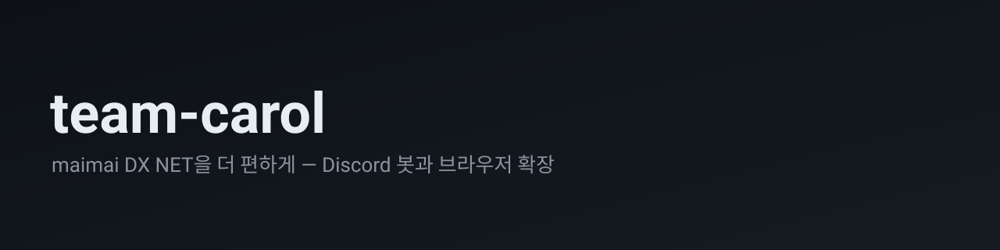
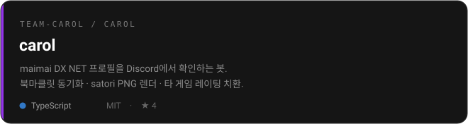
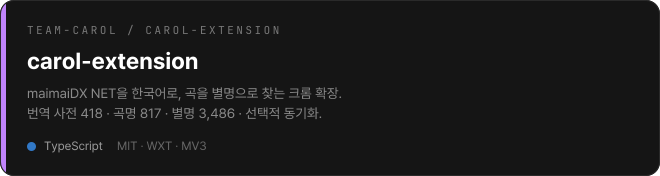
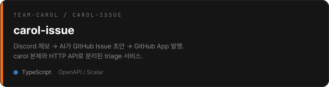
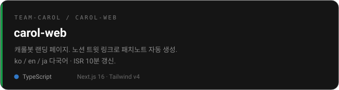

<!--
  team-carol 조직 프로필 (https://github.com/team-carol)
  디자인 출처: team-carol/carol → docs/DESIGN.md + src/web/*
  팔레트: canvas #0d0d0d · surface #1a1a1a · border #252525 · accent #9333ea / #c084fc
  assets/*.svg 는 satori(Pretendard + JetBrains Mono)로 렌더 → 글리프가 모두
  <path> 로 아웃라인되어 폰트 의존성이 없습니다. 재생성: scripts/gen-assets.js
-->

  <picture>
    <source media="(prefers-color-scheme: dark)"  srcset="./assets/banner-dark.svg">
    <source media="(prefers-color-scheme: light)" srcset="./assets/banner-light.svg">
    
  </picture>

  
  
  

### <samp>ABOUT</samp>

**carol** 은 [maimai DX NET](https://maimaidx-eng.com/) 프로필을 Discord에서 확인하는 봇입니다.
SEGA 계정 정보를 받지 않고, 사용자가 이미 로그인해 둔 브라우저에서 실행한 **북마클릿이 보내주는 HTML만 파싱**합니다.
프로필·최근 플레이·레이팅표 이미지, CHUNITHM / SDVX / Arcaea 레이팅 체계 환산, 일일 성과 카드(`/성과`) 등을 제공합니다.

`team-carol` 은 carol 봇과 그 주변 도구 — 브라우저 확장, 제보 triage 서비스, 랜딩 페이지 — 를 함께 개발합니다.

### <samp>PROJECTS</samp>

<table border="0" cellspacing="0" cellpadding="0">
  <tr>
    <td width="50%"></td>
    <td width="50%"></td>
  </tr>
  <tr>
    <td width="50%"></td>
    <td width="50%"></td>
  </tr>
</table>

이 외에 <b>Qcard</b> (workspace · server · application · firmware) 를 비공개로 개발 중입니다.

### <samp>STACK</samp>

  
  
  
  
  
  
  
  

- 봇 웹 서버는 프레임워크 없이 Node.js `http` 로 수동 라우팅
- 레이팅표·성과 카드 이미지는 `satori`(JSX → SVG) + `@resvg/resvg-js`(SVG → PNG)
- 공유 디자인 시스템: [`carol/docs/DESIGN.md`](https://github.com/team-carol/carol/blob/main/docs/DESIGN.md)

### <samp>CONTRIBUTE</samp>

  
  
  

버그·기능 제안은 각 레포의 Issues, carol 이용 중이라면 Discord `/문의` 로 받습니다.

  carol 은 SEGA 및 maimai 와 무관한 비공식 프로젝트입니다.&nbsp;&nbsp;·&nbsp;&nbsp;© 2026 team-carol

