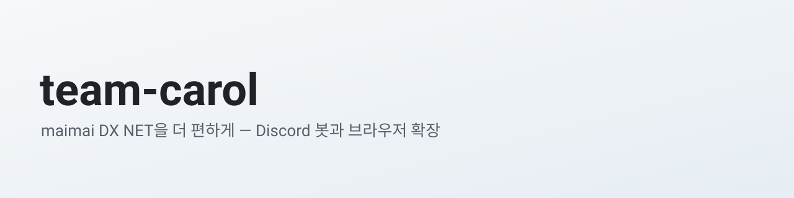

<!--
  이 파일은 조직 프로필 페이지(https://github.com/team-carol)에 렌더링됩니다.
  경로 규칙: team-carol/.github 레포의 profile/README.md
-->

  <picture>
    <source media="(prefers-color-scheme: dark)"  srcset="./assets/banner-dark.svg">
    <source media="(prefers-color-scheme: light)" srcset="./assets/banner-light.svg">
    
  </picture>

<h1 align="center">team-carol</h1>

  <em>maimai DX NET을 더 편하게 — Discord 봇과 브라우저 확장을 만듭니다.</em>

  <a href="https://maimai.bitworkspace.kr">🌐 carol 서버</a> &nbsp;·&nbsp;
  <a href="https://maimai.bitworkspace.kr/invite">🤖 봇 초대</a> &nbsp;·&nbsp;
  <a href="https://github.com/orgs/team-carol/discussions">💬 Discussions</a>

  
  
  

---

## 👋 소개

**carol** 은 [maimai DX NET](https://maimaidx-eng.com/) 프로필을 Discord에서 확인하는 봇입니다.
SEGA 계정 정보를 받지 않고, 사용자가 이미 로그인해 둔 브라우저에서 실행한 **북마클릿이 보내주는 HTML만 파싱**합니다.
프로필·최근 플레이·레이팅표 이미지, CHUNITHM / SDVX / Arcaea 레이팅 체계로의 환산, 일일 성과 카드 등을 제공합니다.

`team-carol` 은 carol 봇과 그 주변 도구(브라우저 확장, 제보 triage 서비스, 랜딩 페이지)를 함께 개발합니다.

## 🚀 프로젝트

| 프로젝트 | 설명 | 스택 |
| --- | --- | --- |
| [**carol**](https://github.com/team-carol/carol) ⭐ | maimai DX NET 프로필 확인 Discord 봇. 북마클릿 기반 동기화, `satori` + `resvg` PNG 렌더링, 타 게임 레이팅 치환, 일일 성과(`/성과`) | TypeScript · Node.js `http` · SQLite |
| [**carol-extension**](https://github.com/team-carol/carol-extension) | maimaiDX NET을 한국어로 보고 곡을 별명으로 찾는 크롬 확장. 번역 사전 418개, 곡명 817곡, 별명 3,486개. 선택적 carol 프로필 동기화 | TypeScript · WXT · MV3 · pnpm |
| [**carol-issue**](https://github.com/team-carol/carol-issue) | Discord 제보를 받아 AI로 GitHub Issue 초안을 만들고 GitHub App으로 발행하는 triage 서비스. carol 본체와 HTTP API로 분리 | TypeScript · OpenAPI/Scalar |
| [**carol-web**](https://github.com/team-carol/carol-web) | 캐롤봇 랜딩 페이지. 노션 DB의 트윗 링크로 패치노트를 자동 생성, ko/en/ja 다국어 | Next.js 16 · Tailwind CSS v4 |
| [**.github**](https://github.com/team-carol/.github) | 이 프로필과 조직 전체 기본 커뮤니티 파일 | — |

이 외에 <strong>Qcard</strong> (workspace · server · application · firmware) 를 비공개로 개발 중입니다.

## 🛠️ 기술 스택

  
  
  
  
  
  
  
  

- 봇 웹 서버는 프레임워크 없이 Node.js `http` 로 수동 라우팅
- 레이팅표·성과 카드 이미지는 `satori` (JSX → SVG) + `resvg` (SVG → PNG)
- 배포는 Docker + Cloudflare Tunnel

## 🤝 참여하기

- 💬 [Discussions](https://github.com/orgs/team-carol/discussions) — 질문과 아이디어
- 🐛 버그·기능 제안은 각 레포의 Issues, carol 이용 중이라면 Discord `/문의`
- 📄 [기여 가이드](https://github.com/team-carol/.github/blob/main/CONTRIBUTING.md) · [행동 강령](https://github.com/team-carol/.github/blob/main/CODE_OF_CONDUCT.md)

  carol 은 SEGA 및 maimai 와 무관한 비공식 프로젝트입니다. © 2026 team-carol

